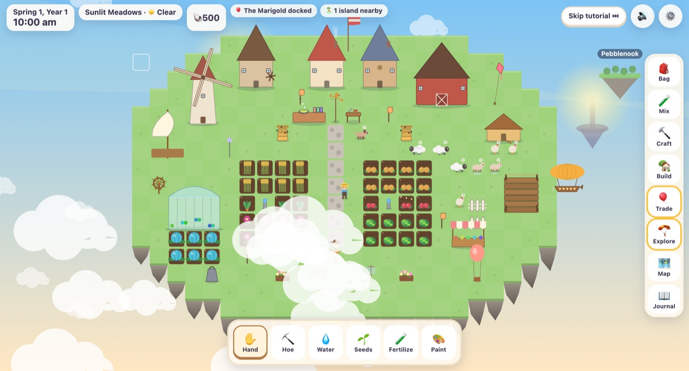

# 🌤️ Driftfield

**A cozy sky-farming game about losing everything, and growing it back.**

You live on a floating island that drifts slowly through the sky, past other islands, airship trade routes and changing weather. Then a storm tears it apart. You wake up on a single small rock with a seed pouch, a broken windmill, and Wendell, a talking weather vane who says: *"We built it once. We can build it again."*

Mix strange products, crossbreed new crops, breed animals, recover pieces of your lost island, and repair the Great Sky Beacon. The game is full of combinational systems, so there's always something new to discover.

### ▶ Play: [driftfield.carterscoding.com](https://driftfield.carterscoding.com)


*The Perfect Island, just before the storm. (Replace `assets/screenshot.png` with your own favourite moment.)*

---

## How to play

| Control | Desktop | Phone / tablet |
| --- | --- | --- |
| Use a tool on a tile | Click | Tap |
| Move the camera | Drag, or arrow keys / WASD | Drag |
| Zoom | Mouse wheel | Pinch |
| Choose a tool | Toolbar or keys **1–6** | Toolbar |
| Rotate a land chunk | **R** or ⟳ | ⟳ button |
| Close a window | **Esc** | ✕ |

When placing something on a touch screen, the first tap previews it and a second tap on the same spot confirms.

**The basics**
1. **Hoe** the ground, plant **Seeds**, then **Water**. Crops grow a little each night.
2. Crops have favourite **climates**. As your island drifts into new zones, some grow fast, some slowly, and in the frozen zone some stop entirely. A Greenhouse ignores all of that.
3. **Sleep** (after 5 pm) to end the day. The game saves every morning.
4. **Explore**: islands drift past every day. Glide over to gather materials, find seeds, meet people, and recover pieces of your old island.
5. **Trade** with airships that dock. Build a Dock and Market Stall to attract more of them.

**The discovery systems**
- **Mixing Station**: pick a base (juice, jam, tea, honey, soup, fertilizer, dye, potion, feed), then add ingredients one at a time. Ingredients *add* effects, *transform* existing ones (Storm Pepper turns Calming into Energizing), and effects *fuse* (Sweet + Sour → Zesty). Order matters. There are 44 effects, 19 fusions and dozens of transforms, so thousands of products are possible. Effects decide the name, colour, value and use (Floaty potions let you glide farther; Speedy fertilizer grows crops faster).
- **Crossbreeding**: plant two different crops side by side. When both are ripe they may cross-pollinate (look for sparkles). Harvest for a hybrid seed that mixes traits (colour, size, flavour, growth, climate, yield and rare traits like Glowing or Floating), with a chance of mutation. Breed hybrids of hybrids. Eight **legendary** crops are hidden behind specific breeding chains and zones.
- **Animals**: nine species, from cloud sheep to cumulus cows. What they eat changes what they make: feed a sheep sunfruit and you get Golden Wool. Bees flavour honey with nearby flowers. Happy animals have babies that inherit their parents' coats **and traits** (Quick, Lucky, Extra Fluffy, Musical…), and now and then a baby is born with a brand-new trait. Breed for the best producers.
- **Crafting**: some recipes are known; most are discovered by experimenting on the bench or found as blueprints.
- **Customisation**: attach land chunks like puzzle pieces, place and move buildings and decorations, change roof styles, paint anything with dyes you've mixed, and design your outfit, flag, sails and balloon.
- **Journal**: Mix Journal (name and repeat your recipes), Seed Almanac with a family tree for every hybrid, Discovery Log with completion percentages, quests, the drift map and the Beacon.
- **Festivals**: eight a year, with contests for the best dye, crop, mix, animal product, biggest crop and most remarkable hybrid, plus Lantern Night and Starfall.

**The story**: repair the Great Sky Beacon in five stages and gather clues about what really caused the storm. Lighting the Beacon opens a second chapter with someone very old and very sleepy. After that, the game carries on in endless mode.

---

## Run it locally

The game uses ES modules, which browsers won't load from `file://`, so serve the folder with any static server:

```bash
# Option 1: Node
npx serve .

# Option 2: Python
python3 -m http.server 8000
# then open http://localhost:8000
```

Or open the folder in VS Code and use the **Live Server** extension. There is no build step and no dependencies.

---

## Deploy with GitHub Pages (+ custom domain)

1. Push this repo to GitHub (`cksarge/Driftfield`).
2. On GitHub go to **Settings → Pages**. Under *Build and deployment* choose **Deploy from a branch**, branch **main**, folder **/ (root)**, then Save.
3. The repo already contains a `CNAME` file with `driftfield.carterscoding.com`, so Pages picks up the custom domain automatically. (You can confirm it under Settings → Pages → Custom domain.)
4. At your DNS provider for `carterscoding.com`, add this record:

   | Type | Name / Host | Value / Target |
   | --- | --- | --- |
   | `CNAME` | `driftfield` | `cksarge.github.io` |

5. Wait for DNS to propagate (minutes to a few hours), then tick **Enforce HTTPS** in Settings → Pages.

All paths in the code are relative (`./js/...`), so the game works on the custom domain, on `cksarge.github.io/Driftfield/`, or in any subfolder.

## Install as an offline app

Driftfield is a Progressive Web App. After the first visit, the service worker caches every file, so the game runs with no internet.
- **Chrome / Edge (desktop):** click the install icon in the address bar, or ⋮ → *Install Driftfield*.
- **Android:** ⋮ → *Add to Home screen* / *Install app*.
- **iPhone / iPad (Safari):** Share → *Add to Home Screen*.

**Saves** live in your browser's local storage (3 slots). Use **⚙️ → Export Save** to download a backup file, and **Import Save** (in-game or from *Save Slots* on the title screen) to move your island to another device.

> **Updating the game?** Run `node tools/build-sw.mjs` before committing. It rewrites the offline file list in `service-worker.js` and sets `CACHE_VERSION` from the files' contents, so installed copies pick up the update. (No Node? Bump `CACHE_VERSION` by hand and add any new file paths to `FILES`.)

---

## Adding new content (no game logic needed)

All content lives in `/data` as plain JavaScript objects. Each file has a comment at the top explaining its fields. Some examples:

- **A new crop**: add an entry to `CROPS` in `data/crops.js` with `traits` (hue, size, flavor, growth, climates, yield, rare). It immediately works with breeding, mixing, trading and the Almanac. Add its seeds to a trader's `sells` list in `data/traders.js` or to an island's `seeds` spot in `data/islands.js`.
- **A new effect**: add it to `EFFECTS` in `data/effects.js`, then use it in an ingredient's `mix.adds` / `mix.transforms` (in `data/items.js` or a crop) or in a `COMBOS` fusion.
- **A new legendary crop**: add it to `LEGENDARIES` with a `requires` block (rare traits, flavour, zone, weather, generation, lineage…).
- **A new animal**: add it to `ANIMALS` in `data/animals.js`, add a painter for it in `js/art.js` → `drawAnimal`, and sell it from a trader. New inheritable traits go in `ANIMAL_TRAITS` in the same file.
- **A new festival**: `data/festivals.js`. Contests can judge `dye`, `crop`, `mix`, `product`, `giant` (size) or `hybrid` entries.
- **Post-Beacon content**: give an island or quest `after: 'lit'` and it only appears once the Beacon shines. Events take the same flag.
- **A new island**: add to `data/islands.js` with the zones it appears in and its `spots` (gather, seeds, chest, npc, piece, secret).
- **A new character / quest**: `data/characters.js` + `data/quests.js`.
- **A new decoration**: `data/decorations.js` (pick an existing `art` style, or add a painter in `js/art.js` → `drawDeco`).
- **A new recipe**: `data/recipes.js`. Leave out `known: true` to make it a secret to discover, and give it a `hint`.
- **Also data-driven**: buildings, zones and weather, traders, events, lost pieces, clothing, land shapes, the Beacon stages, clues, the second chapter and the tutorial script.

After editing content, run **`node tools/check-data.mjs`**. It checks that every item, seed, character, quest, portrait, prize and event visual you named actually exists, and lists anything that doesn't.

---

## Project structure

```
index.html            Page layout: canvas, HUD, toolbar, panels, title screen
manifest.json         PWA manifest (name, icons, colours)
service-worker.js     Offline cache (bump CACHE_VERSION when files change)
CNAME                 Custom domain for GitHub Pages
css/
  base.css            Colours, type, buttons
  hud.css             HUD, toolbar, sidebar, dialogue, toasts, phone layout
  panels.css          Windows, grids, cards, mixing, journal, map, title screen
  animations.css      Small UI animations (respects reduced motion)
js/
  main.js             Boot, game loop, sleeping, wiring events to the UI
  state.js            The single saved game-state object + discovery helper
  events.js           Tiny event bus so systems don't import each other
  time.js             In-game clock, calendar, day/night
  day.js              Everything that happens overnight, random events
  island.js           Land tiles, puzzle-piece chunks, objects, weight & tilt
  farming.js          Till, plant, water, fertilize, growth, pollination
  breeding.js         Crossbreeding, mutations, hybrid naming, legendaries
  mixing.js           Mixing Station rules (adds → transforms → fusions), buffs
  animals.js          Feeding, products, honey, animal breeding, wandering
  navigation.js       Drifting through zones, steering, weather rolls
  trading.js          Airships, prices, demand, delivery requests
  exploration.js      Passing islands, glider, spots, lost pieces
  buildings.js        Building/decor placement, painting, roofs, windmill, daily jobs
  crafting.js         Recipe book and bench experiments
  quests.js           Characters, friendship, gifts, quests
  needs.js            Shared "what someone wants" checker (quests, Beacon, deliveries)
  story.js            The Great Sky Beacon and clues
  festivals.js        Seasonal festivals, contests, Starfall
  customize.js        Outfit/hat unlocks, colour palette
  tutorial.js         The Perfect Island, the storm, waking up
  items.js            Item keys, item info, inventory
  save.js             Save slots (localStorage with fallback), export/import
  render.js           Draws sky, island, weather, lighting, effects
  art.js              Every picture, painted with canvas shapes (no image files)
  audio.js            Procedural Web Audio music & sound effects (no audio files)
  input.js            Mouse, touch, pinch, keyboard
  interact.js         What each tool does when you tap the world
  ui/                 HUD & panels: ui.js (core), bag, mixpanel, craftpanel,
                      buildpanel, tradepanel, explorepanel, journal, menus
data/                 All game content (see "Adding new content")
assets/icons/         App icons (SVG + generated PNGs)
assets/music/         Space for recorded music (see its README; empty for now)
tools/
  build-sw.mjs        Refreshes the offline file list + cache version
  check-data.mjs      Finds broken references in /data
```

---

## Credits & license

- Design and code: Carter K, built with help from Claude (Anthropic).
- All art is drawn procedurally with the Canvas API, all music and sound is synthesised live with the Web Audio API, and the UI uses system fonts. There are no third-party assets and nothing loads from external servers.
- If recorded music is added later, its credits and licenses live in [`assets/music/credits.txt`](assets/music/credits.txt).
- Licensed under the **MIT License**. See [`LICENSE`](LICENSE). © 2026 Carter K.
